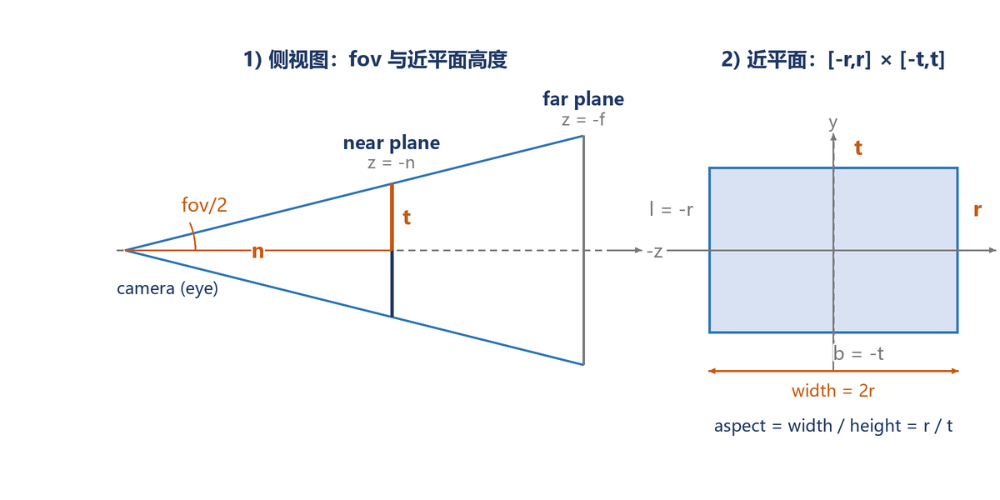
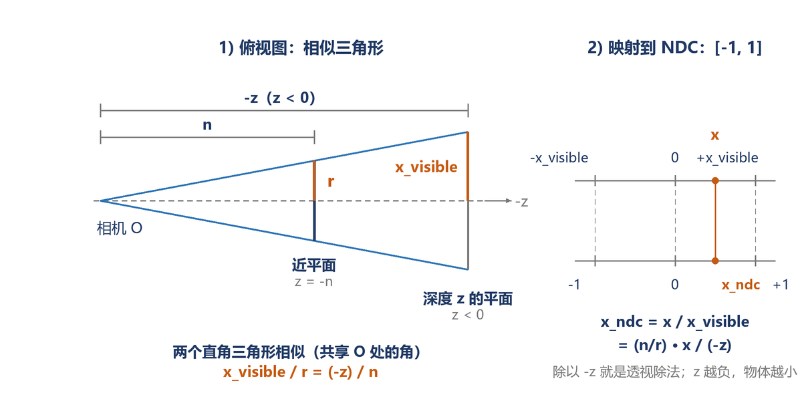
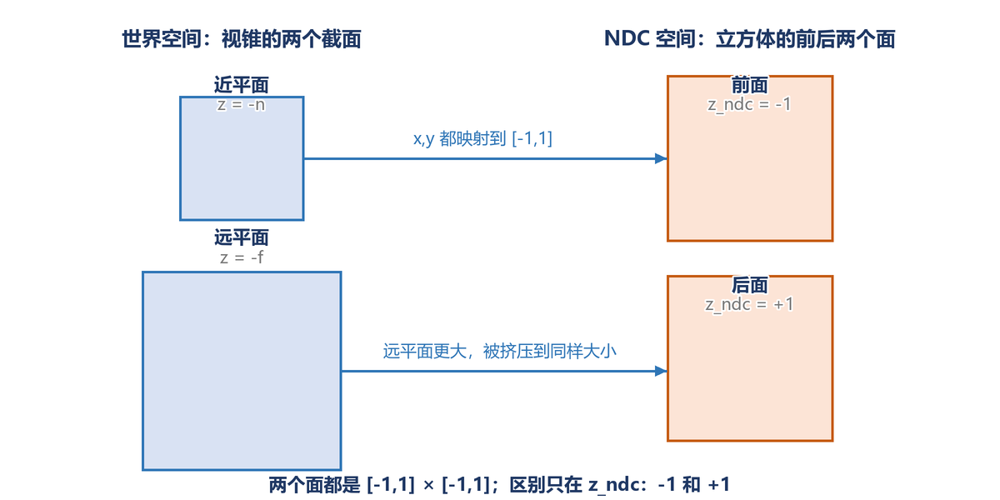

# 第 04 讲：变换（模型、视图、投影）

这一讲只解决一件事：**一个三维物体，怎么一步步变成屏幕上的像素坐标。**

整条链路：

\[
\mathbf{p}_{screen}
\sim
\text{viewport}
\cdot
\underbrace{P}_{\text{投影}}
\cdot
\underbrace{V}_{\text{视图}}
\cdot
\underbrace{M}_{\text{模型}}
\cdot
\mathbf{p}_{local}
\]

本讲负责 \(M\)、\(V\)、\(P\) 三个矩阵；viewport 那一步由光栅器的 `draw()` 代劳。

---

## 1. 三维变换：4×4 齐次矩阵

二维用 3×3，三维用 4×4，道理一样：多出来的一维让平移也能写成矩阵乘法。

点 \((x,y,z,1)\)，向量 \((x,y,z,0)\)。

### 缩放

\[
S(s_x,s_y,s_z)=
\begin{bmatrix}
s_x&0&0&0\\
0&s_y&0&0\\
0&0&s_z&0\\
0&0&0&1
\end{bmatrix}
\]

### 平移

\[
T(t_x,t_y,t_z)=
\begin{bmatrix}
1&0&0&t_x\\
0&1&0&t_y\\
0&0&1&t_z\\
0&0&0&1
\end{bmatrix}
\]

### 绕坐标轴旋转

绕 \(x\) 轴：

\[
R_x(\alpha)=
\begin{bmatrix}
1&0&0&0\\
0&\cos\alpha&-\sin\alpha&0\\
0&\sin\alpha&\cos\alpha&0\\
0&0&0&1
\end{bmatrix}
\]

绕 \(y\) 轴：

\[
R_y(\alpha)=
\begin{bmatrix}
\cos\alpha&0&\sin\alpha&0\\
0&1&0&0\\
-\sin\alpha&0&\cos\alpha&0\\
0&0&0&1
\end{bmatrix}
\]

绕 \(z\) 轴：

\[
R_z(\alpha)=
\begin{bmatrix}
\cos\alpha&-\sin\alpha&0&0\\
\sin\alpha&\cos\alpha&0&0\\
0&0&1&0\\
0&0&0&1
\end{bmatrix}
\]

作业 1 的基础题就是 \(R_z\)。角度用弧度。

### 绕任意轴旋转：Rodrigues 公式

轴 \(\mathbf{n}=(n_x,n_y,n_z)\)，先归一化，角度 \(\alpha\)：

\[
R(\mathbf{n},\alpha)=
\cos\alpha\, I
+(1-\cos\alpha)\,\mathbf{n}\mathbf{n}^T
+\sin\alpha\,[\mathbf{n}]_\times
\]

其中

\[
[\mathbf{n}]_\times=
\begin{bmatrix}
0&-n_z&n_y\\
n_z&0&-n_x\\
-n_y&n_x&0
\end{bmatrix}
\]

这是作业 1 的提高题。先别急，基础题过掉再写。

---

## 2. MVP 分别干什么

| 矩阵 | 作用 | 坐标系变化 |
| --- | --- | --- |
| \(M\) 模型 | 把物体从自己的局部坐标摆到世界 | local → world |
| \(V\) 视图 | 把相机移到原点、看向 \(-z\) | world → camera |
| \(P\) 投影 | 把视锥/盒子压到 \([-1,1]^3\) | camera → NDC |

最后 viewport 把 NDC 的 \([-1,1]^2\) 映射到屏幕像素，深度映射到 \([0,1]\) 或深度缓冲区间。

矩阵乘法顺序：**右边的先作用**。所以是 \(P\cdot V\cdot M\cdot p\)，不是 \(M\cdot V\cdot P\cdot p\)。

---

## 3. 视图变换 \(V\)

作业 1 里相机在 \((0,0,5)\)，看向 \(-z\)，上方向 \(+y\)。把相机移到原点，世界就整体平移 \(-\text{eye}\)：

\[
V=
\begin{bmatrix}
1&0&0&-5\\
0&1&0&0\\
0&0&1&0\\
0&0&0&1
\end{bmatrix}
\]

框架里的 `get_view_matrix` 已经写好，不用改。

更一般的情况：相机在 `eye`，看向 `center`，上方向 `up`：

\[
\mathbf f=\text{normalize}(\text{center}-\text{eye}),\quad
\mathbf s=\text{normalize}(\mathbf f\times\mathbf{up}),\quad
\mathbf u=\mathbf s\times\mathbf f
\]

\[
R_{view}=
\begin{bmatrix}
s_x&s_y&s_z&0\\
u_x&u_y&u_z&0\\
-f_x&-f_y&-f_z&0\\
0&0&0&1
\end{bmatrix},
\qquad
V=R_{view}\cdot T(-\text{eye})
\]

作业 1 的相机正好看向 \(-z\)，所以 \(R_{view}=I\)，只剩平移。

### `up` 和 `u` 不是一回事

- `up` 是**输入的方向提示**（比如世界坐标的 \((0,1,0)\)），不要求和 \(\mathbf f\) 垂直。
- `u` 是**相机真正的上方向**，由 \(\mathbf s\times\mathbf f\) 算出来，必然和 \(\mathbf f\)、\(\mathbf s\) 都垂直，三者构成正交基。

一般 \(\mathbf u\ne\text{up}\)。关系是：把 `up` 中沿 \(\mathbf f\) 的分量去掉，再归一化：

\[
\mathbf u=
\frac{\text{up}-(\text{up}\cdot\mathbf f)\mathbf f}
{\|\text{up}-(\text{up}\cdot\mathbf f)\mathbf f\|}
\]

这等价于 \(\mathbf s\times\mathbf f\)（\(\mathbf s\) 已归一化时）。

只有当 `up` 已经垂直于 \(\mathbf f\) 且已归一化时，才有 \(\mathbf u=\text{up}\)。作业 1 正好是这种情况：\(\mathbf f=(0,0,-1)\)，\(\text{up}=(0,1,0)\)，点乘为 0，所以 \(\mathbf s=(1,0,0)\)、\(\mathbf u=(0,1,0)=\text{up}\)。

如果 `up` 和 \(\mathbf f\) 平行，叉乘为 0，look-at 退化，需要换一个不平行于 \(\mathbf f\) 的 `up`。

---

## 4. 正交投影

把轴对齐盒子 \([l,r]\times[b,t]\times[-n,-f]\) 映射到 \([-1,1]^3\)。

两步：

1. 把盒子中心平移到原点；
2. 把每个方向的长度缩放到 2。

\[
M_{ortho}=S\cdot T
\]

\[
S=
\begin{bmatrix}
\frac{2}{r-l}&0&0&0\\
0&\frac{2}{t-b}&0&0\\
0&0&\frac{2}{n-f}&0\\
0&0&0&1
\end{bmatrix},
\qquad
T=
\begin{bmatrix}
1&0&0&-\frac{l+r}{2}\\
0&1&0&-\frac{b+t}{2}\\
0&0&1&-\frac{n+f}{2}\\
0&0&0&1
\end{bmatrix}
\]

注意 \(z\) 的缩放分母是 \(n-f\)（负数），因为相机看向 \(-z\)，近平面在 \(z=-n\)，远平面在 \(z=-f\)。代入 \(z=-n\) 得 \(-1\)，代入 \(z=-f\) 得 \(+1\)。

---

## 5. 透视投影

### 5.1 视锥

相机在原点，看向 \(-z\)。近平面 \(z=-n\)，远平面 \(z=-f\)。垂直视场角 `fov`：

\[
t=n\tan\frac{\text{fov}}{2},\qquad r=t\cdot\text{aspect},\qquad l=-r,\qquad b=-t
\]



这些量都是在描述**近平面上的那个矩形**，不是相机的参数：

| 符号 | 名字 | 含义 |
| --- | --- | --- |
| \(n\) | near | 相机到近平面的距离（正数） |
| \(f\) | far | 相机到远平面的距离（正数） |
| `fov` | 垂直视场角 | 上下两条视线的夹角 |
| `aspect` | 宽高比 | 近平面矩形的宽 / 高 |
| \(t\) | top | 近平面矩形上边界的 \(y\) 坐标 |
| \(b\) | bottom | 下边界，\(b=-t\) |
| \(r\) | right | 右边界 \(x\) 坐标 |
| \(l\) | left | 左边界，\(l=-r\) |

为什么 \(t=n\tan(\text{fov}/2)\)：从侧面看，相机 \(O\)、近平面中心、近平面顶端构成一个直角三角形。斜边是上视线，邻边是 \(n\)，对边是 \(t\)，\(O\) 处的角是 \(\text{fov}/2\)，所以

\[
\tan\frac{\text{fov}}{2}=\frac{t}{n}
\quad\Longrightarrow\quad
t=n\tan\frac{\text{fov}}{2}
\]

为什么 \(r=t\cdot\text{aspect}\)：矩形的宽高比

\[
\text{aspect}=\frac{2r}{2t}=\frac{r}{t}
\quad\Longrightarrow\quad
r=t\cdot\text{aspect}
\]

例：`fov = 45°`、`n = 0.1`、`aspect = 1`：

\[
\text{fov}/2=22.5^\circ,\quad
\tan22.5^\circ\approx0.4142,\quad
t=0.1\times0.4142=0.04142
\]

所以 \(t=r=0.04142\)，\(l=b=-0.04142\)。近平面只有 \(0.0828\times0.0828\) 大，但投影矩阵会把它拉伸到 NDC 的 \([-1,1]^2\)。

### 5.2 相似三角形



先看左边（俯视图，x-z 平面）：

- 相机在 \(O\)，看向 \(-z\)。
- 近平面在距离 \(n\) 处，半宽是 \(r\)（橙色段）。
- 在深度 \(z\)（\(z<0\)）处，视锥的半宽是 \(x_{\text{visible}}\)（另一段橙色）。
- 近平面边缘、深度 \(z\) 处边缘，各自与 \(O\) 构成一个直角三角形。两个三角形在 \(O\) 处共享同一个角，所以**相似**。

相似三角形对应边成比例：

\[
\frac{x_{\text{visible}}}{r}=\frac{-z}{n}
\quad\Longrightarrow\quad
x_{\text{visible}}=r\cdot\frac{-z}{n}
\]

注意 \(x_{\text{visible}}\) 不是常数：深度越深（\(-z\) 越大），可见范围越宽，而且是**线性**增长。近平面处 \(x_{\text{visible}}=r\)，到远平面处就按距离等比放大。

现在把同一个点 \(x\) 压到 \([-1,1]\)。这一层可用的区间是 \([-x_{\text{visible}},x_{\text{visible}}]\)，所以：

\[
x_{ndc}=\frac{x}{x_{\text{visible}}}
=\frac{x}{r\cdot(-z)/n}
=\frac{n}{r}\cdot\frac{x}{-z}
\]

同理：

\[
y_{ndc}=\frac{n}{t}\cdot\frac{y}{-z}
\]

右图：固定深度 \(z\) 时，\(x_{\text{visible}}\) 就是“当前这一层”的半宽；\(x\) 除以它，就得到 \([-1,1]\) 里的比例。\(x=0\) 在中间，\(x=\pm x_{\text{visible}}\) 在两边。

**为什么叫透视除法**：透视矩阵把 \(w\) 设成 \(-z\)，最后除以 \(w\) 就是除以深度。越远（\(-z\) 越大），同样的 \(x\) 得到的 \(x_{ndc}\) 越小，所以“近大远小”。

**注意**：这里的 \(z\) 是点的深度坐标（负数），\(-z\) 才是正的距离；不要把它和固定的近平面距离 \(n\) 混了。\(n\) 不变，\(-z\) 随点变化，所以每个点除的是自己那一层的深度。

### 5.3 投影矩阵

用齐次坐标把除法藏进 \(w\)：

\[
P=
\begin{bmatrix}
\frac{n}{r}&0&0&0\\
0&\frac{n}{t}&0&0\\
0&0&A&B\\
0&0&-1&0
\end{bmatrix}
\]

这样

\[
P\begin{bmatrix}x\\y\\z\\1\end{bmatrix}
=
\begin{bmatrix}
\frac{n}{r}x\\
\frac{n}{t}y\\
Az+B\\
-z
\end{bmatrix}
\]

除以 \(w=-z\) 就得到上面的 \(x_{ndc},y_{ndc}\)。最后一行必须是 \((0,0,-1,0)\)：相机看向 \(-z\)，\(w=-z>0\)。

#### 逐行读这个矩阵

矩阵乘法本身做不了除法。齐次坐标的套路是：先乘出一个四维向量，最后再统一除以它的第四个分量 \(w\)。所以这个矩阵的任务不是“直接算出 NDC”，而是算出四个“待除”的数：

| 行 | 矩阵这一行给出的 | 除以 \(w=-z\) 之后 |
| --- | --- | --- |
| 第 1 行 | \(x_{clip}=\frac{n}{r}x\) | \(x_{ndc}=\frac{n}{r}\cdot\frac{x}{-z}\) |
| 第 2 行 | \(y_{clip}=\frac{n}{t}y\) | \(y_{ndc}=\frac{n}{t}\cdot\frac{y}{-z}\) |
| 第 3 行 | \(z_{clip}=Az+B\) | \(z_{ndc}=\frac{Az+B}{-z}\) |
| 第 4 行 | \(w=-z\) | 分母，不参与“映射” |

容易误会的是第 4 行：它不是深度的映射，而是**除法要用的分母**。相机看向 \(-z\)，所以视锥里的点 \(z<0\)，\(-z\) 才是正的距离；让 \(w=-z>0\)，除以它才不会把符号翻过来。

### 5.4 求 \(A,B\)

要求近平面映射到 \(z_{ndc}=-1\)，远平面映射到 \(z_{ndc}=+1\)：

\[
\frac{A(-n)+B}{n}=-1,
\qquad
\frac{A(-f)+B}{f}=+1
\]

解得

\[
A=\frac{n+f}{n-f},
\qquad
B=\frac{2nf}{n-f}
\]

所以

\[
P=
\begin{bmatrix}
\frac{n}{r}&0&0&0\\
0&\frac{n}{t}&0&0\\
0&0&\frac{n+f}{n-f}&\frac{2nf}{n-f}\\
0&0&-1&0
\end{bmatrix}
\]

验算：

- \(z=-n\)：分子 \(-\frac{n(n+f)}{n-f}+\frac{2nf}{n-f}=\frac{n(f-n)}{n-f}=-n\)，除以 \(n\) 得 \(-1\)。
- \(z=-f\)：分子 \(-\frac{f(n+f)}{n-f}+\frac{2nf}{n-f}=\frac{f(n-f)}{n-f}=f\)，除以 \(f\) 得 \(+1\)。

#### 把 \(A,B\) 解出来

把两个方程乘开：

\[
-An+B=-n,\qquad -Af+B=f
\]

两式相减（下减上）：

\[
A(n-f)=n+f
\quad\Longrightarrow\quad
A=\frac{n+f}{n-f}
\]

代回第一式：

\[
B=An-n
=\frac{n(n+f)}{n-f}-n
=\frac{n(n+f)-n(n-f)}{n-f}
=\frac{2nf}{n-f}
\]

注意 \(n-f<0\)，所以 \(A<0\)、\(B<0\)。这不是错误：\(z\) 本身是负的，而我们要把它映射到 \([-1,1]\)。

#### 数值直觉

取 \(n=0.1,\ f=50\)：

\[
A=\frac{50.1}{-49.9}\approx-1.004,\qquad
B=\frac{10}{-49.9}\approx-0.2004
\]

验算：

- \(z=-0.1\)：\(Az+B=0.1004-0.2004=-0.1\)，\(w=0.1\)，\(z_{ndc}=-1\)。
- \(z=-50\)：\(Az+B=50.2-0.2004\approx50\)，\(w=50\)，\(z_{ndc}=1\)。
- \(z=-7\)：\(Az+B\approx7.028-0.2004=6.828\)，\(w=7\)，\(z_{ndc}\approx0.975\)。

深度和 \(z_{ndc}\) 的对应：

| \(z\) | -0.1 | -0.2 | -1 | -7 | -50 |
| --- | --- | --- | --- | --- | --- |
| \(z_{ndc}\) | -1 | 0.002 | 0.804 | 0.975 | 1 |

看出两件事：

1. \(z_{ndc}\) 不是线性的。深度从 0.1 到 0.2 就跨了 \(-1\to0.002\)，而 0.2 到 50 才慢慢走到 1。
2. 深度缓冲的精度集中在近平面附近，所以近平面不能设得太小，否则远处容易 z-fighting。

如果把最后一行写成 \((0,0,1,0)\)，\(w=z<0\)：近平面会映射到 \(+1\)、远平面到 \(-1\)，\(x\) 也会反号，图像会镜像、深度反转。这就是为什么必须是 \(-1\)。

#### 近平面和远平面分别投影到哪？



- 近平面（视锥的小截面）→ NDC 立方体的**前面**，\(z_{ndc}=-1\)。
- 远平面（视锥的大截面）→ NDC 立方体的**后面**，\(z_{ndc}=+1\)。
- 两个面的 \(x,y\) 范围都是 \([-1,1]\)；远平面在世界里更大，所以被缩得更小（“挤压”）。
- 它们**没有被压到同一个平面上**：它们是 NDC 立方体的前后两个面，深度不同。
- 最终的屏幕图像只用 \(x,y\)；\(z_{ndc}\) 存到深度缓冲，用来判断谁遮挡谁。

如果把“投影”理解成小孔成像：像是成在近平面（或距离 1 的平面）上的，从眼睛出发的同一条射线上的点落到同一个像素；远近平面的区别只体现在深度和大小，不改变像素位置。

### 5.5 和课件“挤压 + 正交”的关系

课件把透视拆成两步：先把视锥“挤”成盒子，再做正交投影。两种写法等价，但符号约定容易混。上面这个单矩阵是直接按 NDC 定义推的，作业 1 用它最省事，也不会出现“三角形上下颠倒”的问题。

### 5.6 NDC 是 \([-1,1]^3\)，但不是“线性缩放”

是的，视锥里的点经过投影后，会被“塞进”一个 \(x,y,z\in[-1,1]\) 的立方体，这就是 NDC。但“塞”不是同一个线性缩放：

| 变化 | 是否线性 | 原因 |
| --- | --- | --- |
| 固定 \(z\)，改变 \(x\) | 是 | \(x_{ndc}\propto x\) |
| 固定 \(x\)，改变 \(z\) | 否 | \(x_{ndc}\propto 1/(-z)\)，\(z\) 翻倍，\(x_{ndc}\) 减半 |
| 改变 \(z\)，看 \(z_{ndc}\) | 否 | \(z_{ndc}=(Az+B)/(-z)\)，是一条双曲线 |
| 整个 3D 映射 | 不是线性变换 | 是投影变换（projective）：保持直线，但不保持比例、中点 |

例子（\(n/r\approx2.414\)）：

- 固定 \(z=-1\)：\(x=0.1,0.2,0.3\) → \(x_{ndc}=0.241,0.483,0.724\)，等步长，线性。
- 固定 \(x=0.2\)：\(z=-1,-2,-4\) → \(x_{ndc}=0.483,0.241,0.121\)，\(z\) 翻倍就减半，不是线性。
- \(z_{ndc}\)：\(z=-0.1\to-1\)，\(z=-0.2\to0.002\)，\(z=-1\to0.804\)，\(z=-50\to1\)，明显不是直线。

所以：

- 对同一个深度切片，\(x,y\) 是线性缩放的；
- 跨深度时，缩放比例 \(n/(r(-z))\) 自己在变，所以整体不是线性的；
- 深度方向被故意压缩成非线性，把精度留给近处。

另外，NDC 的 \(z\) 范围在 GAMES101/OpenGL 里是 \([-1,1]\)；DirectX/Vulkan 用 \([0,1]\)，矩阵的 \(A,B\) 会不一样。作业用 \([-1,1]\)。

---

## 6. 作业 1 要写什么

`hw/hw1/main.cpp` 里只有两个 TODO：

1. `get_model_matrix(float rotation_angle)`：返回 \(R_z\) 的 4×4 形式。
2. `get_projection_matrix(float eye_fov, float aspect_ratio, float zNear, float zFar)`：返回上面的 \(P\)。

`get_view_matrix` 已经写好。

### 检查清单

- 角度转弧度：`rad = angle / 180.0f * PI`。
- `fov` 也要转弧度，再取一半：`t = n * tan(fov / 2)`。
- `zNear`、`zFar` 是正的距离（0.1、50），不是坐标；坐标是 \(-n\)、\(-f\)。
- 矩阵 \(P\) 的 `(3,2)` 是 \(-1\)，不是 \(+1\)。
- Eigen 的 `<<` 按行填；用 `Matrix4f::Zero()` 再逐项赋值更不容易错。
- 乘法顺序：`projection * view * model`（框架的 `draw()` 已经这么写）。

### 验收

```bat
build.cmd hw1
run.cmd hw1 -r 0  hw1_0.png
run.cmd hw1 -r 45 hw1_45.png
run.cmd hw1 -r 90 hw1_90.png
```

三角形顶点（模型空间）：\((2,0,-2)\)、\((0,2,-2)\)、\((-2,0,-2)\)；相机 \((0,0,5)\)，fov 45°，aspect 1，near 0.1，far 50。

0° 时的像素位置（700×700，图像坐标 y 向下）：

| 顶点 | NDC | 像素 |
| --- | --- | --- |
| \((2,0,-2)\) | \((0.6897,\ 0)\) | \((591,\ 349)\) |
| \((0,2,-2)\) | \((0,\ 0.6897)\) | \((350,\ 108)\) |
| \((-2,0,-2)\) | \((-0.6897,\ 0)\) | \((109,\ 349)\) |

也就是：底边从 \(x\approx109\) 到 \(591\)，在 \(y\approx349\)；顶点在 \((350,108)\)。如果你的图上下颠倒，检查 \(w\) 的符号和 \(z\) 的映射；如果整体太小/太大，检查 `fov` 是否转成了弧度、`aspect` 是否用对。

### 常见错误

| 现象 | 可能原因 |
| --- | --- |
| 全黑 | 投影矩阵把 \(w\) 弄成负数，或者三角形被裁掉；打印 MVP 后的 \(w\) 看看 |
| 三角形上下颠倒 | \(z\) 的符号约定和 \(w\) 行不匹配；用本文的 \(P\) 不会出现 |
| 三角形比预期大很多 | `fov` 忘了转弧度（45 弧度） |
| 旋转方向反了 | \(R_z\) 的 \(\sin\) 符号；图像 y 向下，屏幕上看是反的，正常 |
| 编译过但运行崩 | OpenCV 找不到 Qt 插件；用命令行模式 `run.cmd hw1 -r 0 out.png`，不要开 `imshow` |

### 数值自检

在 `get_projection_matrix` 里临时打印：

```cpp
Eigen::Vector4f p = P * Eigen::Vector4f(0, 2, -7, 1);
std::cout << p.transpose() << " -> " << (p / p.w()).transpose() << std::endl;
```

对 \((0,2,-7,1)\)，期望 \(y_{ndc}=0.6897\)，\(z_{ndc}\approx0.975\)。

---

## 7. 提高题：绕任意轴旋转

基础题通过后再做。把 `get_model_matrix` 换成 Rodrigues：

1. 归一化轴 \(\mathbf n\)；
2. 算 \(R=\cos\alpha I+(1-\cos\alpha)\mathbf n\mathbf n^T+\sin\alpha[\mathbf n]_\times\)；
3. 填进 4×4 的左上角 3×3。

在 `main()` 里把 `get_model_matrix(angle)` 换成 `get_rotation(axis, angle)`，轴取 \((1,1,0)\)，转 45°，观察三角形绕斜轴翻转。

注意事项：

- 归一化是 \(\sqrt{n_x^2+n_y^2+n_z^2}\)，别抄错成 \(n_z+n_z\)。
- 先归一化再算 \(\mathbf n\mathbf n^T\)。
- 4×4 的平移列保持 0，最后一行 \((0,0,0,1)\)。

---

## 8. 自测题

1. 为什么透视投影矩阵的第四行是 \((0,0,-1,0)\)？如果写成 \((0,0,1,0)\) 会怎样？
2. 近平面和远平面分别映射到 NDC 的什么位置？为什么 \(z\) 的缩放分母是 \(n-f\) 而不是 \(f-n\)？
3. 如果 `aspect_ratio` 从 1 变成 2，三角形会变宽还是变窄？用公式解释。
4. 为什么矩阵顺序是 \(P\cdot V\cdot M\)？把顺序换成 \(M\cdot V\cdot P\) 几何上发生了什么？
5. 正交投影和透视投影的本质区别是什么？为什么正交投影不需要除以 \(w\)？
